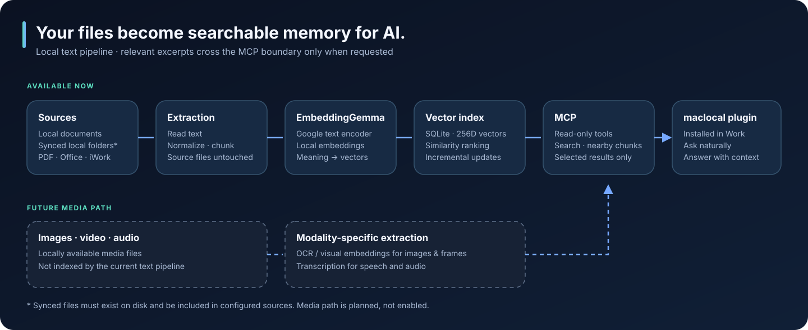

# Local Knowledge Layer

### Turn your computer into memory for AI.

Your computer already holds years of knowledge: decisions, research, reports, notes, and plans. **Local Knowledge Layer for AI** turns the text in files you choose into a semantic index that an AI can search. You no longer need to remember the filename, the folder, or the exact words you used.

> **Just ask. If you have it, it finds it.**



This repository contains a runnable **text-first reference implementation**, a personal MCP plugin template, and synthetic sample data. It contains no personal document corpus or prebuilt index.

## The idea

An AI model cannot know the contents of files it has never seen. Uploading a whole computer is neither necessary nor desirable. Local Knowledge Layer indexes selected files on your machine, retrieves a small set of relevant passages when asked, and exposes those passages through the personal **`maclocal` plugin in Work**. Work can then answer with evidence from your own documents.

```text
Local files → text extraction → chunks → Google EmbeddingGemma 2
            → local vector index → semantic search → read-only MCP
            → maclocal plugin in Work → answer with source context
```

The source files stay where they are. The local SQLite database stores extracted text and vectors, so **the database is sensitive too**. Work receives only the selected search results and context it requests through the plugin; review its data handling before connecting private files.

### The result is a plugin you can actually use

The index and model do the heavy work locally. The convenient part is what you use every day: install the personal `maclocal` plugin in Work, ask a natural-language question, and let it retrieve the relevant passages through MCP. You do not have to open the database, browse folders, or remember search syntax. The plugin turns the local knowledge layer into a practical tool inside your normal Work conversation.

## What is an embedding?

Keyword search looks for matching strings. Semantic search compares meaning. A document might say *“An agent needs authorization before an external action”* while you ask *“Where are the AI approval rules?”* The important words differ, but the ideas are close.

An **embedding model** converts each passage and each question into a vector of numbers. Related passages tend to have nearby vectors. The search routine compares the question vector with indexed passage vectors, ranks the closest matches, and returns the original text plus its source path. That is retrieval, not answer generation; Work uses the retrieved evidence to compose an answer.

This project uses [Google EmbeddingGemma 2](https://ai.google.dev/gemma/docs/embeddinggemma) locally. The model is open weight and [Apache 2.0 licensed](https://huggingface.co/google/embeddinggemma-2), so there is **no per-query embedding API charge** when you run it on your own machine. Your hardware, storage, and electricity still have costs. The reference pipeline loads only its text encoder, uses 256-dimensional normalized vectors, and runs on Apple MPS when available or CPU otherwise. EmbeddingGemma is a powerful component; **the product is the local knowledge layer around it**.

## What runs today

| Component | Current behavior |
| --- | --- |
| Sources | Explicitly configured folders containing locally available files. Source files are read, not modified. |
| Formats | `.pdf`, `.txt`, `.md`, `.rtf`, `.docx`, `.xlsx`, `.xls`, `.odt`, `.ods`, `.pages`, `.numbers`. Legacy `.doc` is detected and skipped. |
| Indexing | Incremental updates, bounded text chunks, content hash deduplication, local SQLite storage. |
| Search | Local query embedding and cosine-style similarity over normalized 256D vectors. |
| MCP | Read-only `search_documents` and `get_document_context` tools over the existing index. |

The current SQLite search scans stored vectors; it is a vector **index of content**, not an approximate-nearest-neighbor engine. For very large collections, adding a dedicated vector search backend is a future performance option. Retrieval quality also depends on extraction, chunking, and the model; a match cannot be guaranteed for every query.

### Local folders, including synchronized folders

Files that Dropbox, Google Drive, or OneDrive have **actually downloaded to disk** are ordinary local files to this scanner. Add their local directory as a source and supported documents can be indexed without a provider-specific cloud API. Online-only placeholders need to be downloaded first. This public reference implementation has no provider-name exclusion; the operator chooses sources and exclusions in `config/config.toml`.

The sample configuration indexes only synthetic `sample_data/`. It will not crawl your home directory by default.

## Try it with synthetic data

Requirements: Python 3.12, [`uv`](https://docs.astral.sh/uv/), and enough memory and disk space to download and run EmbeddingGemma 2. The first run downloads model weights; subsequent searches can work locally from the cache.

```bash
uv sync --python 3.12
./lkl index
./lkl search "Where are the rules for approving agent actions?"
./lkl status
```

The sample note is deliberately generic. Review `config/config.toml`, then add only folders you want indexed. For example:

```toml
sources = ["sample_data", "/absolute/path/to/downloaded/Dropbox/folder"]
```

Keep the path local and ensure cloud files are downloaded. The scanner ignores symbolic links, hidden directories by default, unsupported extensions, and files above the configured size limit. Scanned PDFs need embedded text; OCR is not included today. Some iWork variants may not parse and are logged as skipped.

Run `./lkl index` again to pick up changes. `./lkl search` retrieves passages and paths but does not ask an LLM to answer. See [Architecture](docs/ARCHITECTURE.md) for component and data boundaries.

## Use it as a personal plugin in Work

The personal `maclocal` plugin is the final user-facing layer. In Work, it exposes the existing local index as two read-only tools:

| Tool | Purpose |
| --- | --- |
| `search_documents(query, top_k)` | Return ranked passages with scores, filenames, paths, and chunk IDs. |
| `get_document_context(path, chunk_index)` | Return nearby chunks already stored in SQLite. |

The plugin does not reindex, modify source files, or generate answers. Follow the [personal plugin setup guide](docs/MCP_PLUGIN.md) to prepare a local copy with paths generated on **your** machine. The documented and verified connection is the personal plugin in Work.

## Where it can go next

The **current pipeline is text-only**, even though EmbeddingGemma 2 itself supports [text, image, video, and audio embeddings](https://huggingface.co/google/embeddinggemma-2/blob/main/README.md). Media search requires new ingestion, metadata, and retrieval work:

| Media | Possible extension |
| --- | --- |
| Images | OCR for visible words; visual embeddings for objects and scenes. |
| Video | Frame sampling, visual embeddings/OCR, time references, and optional speech transcription. |
| Audio | Speech transcription for textual search; audio embeddings for sound-level meaning. |

These are roadmap items, not enabled format claims. A future multimodal path could use EmbeddingGemma 2's additional encoders or other suitable models, with separate quality and privacy tests. See the [architecture roadmap](docs/ARCHITECTURE.md#media-roadmap).

## Repository map

```text
src/local_knowledge_layer/   scanner, parsers, chunking, model, SQLite search, CLI
config/config.toml            safe synthetic-data starting configuration
sample_data/                  synthetic first-run example
plugin/maclocal/              personal plugin template and read-only MCP server
scripts/configure_plugin.py   creates an ignored machine-local plugin copy
assets/architecture.svg       technical architecture graphic
docs/                        architecture and plugin setup
tests/                       focused checks using synthetic data
```

No model weights, cache, database, indexed chunks, secrets, or personal source paths belong in this repository. `.gitignore` protects common local artifacts, and contributors should inspect their staged diff before any push.
